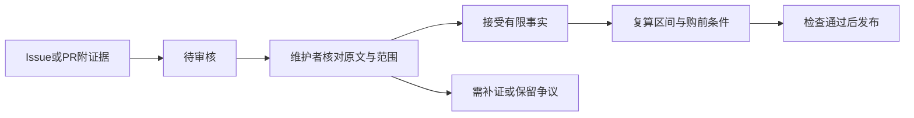

# 速成车选购指南 · QuickCarBuyingGuide

用可追溯的公开证据，判断哪些车更值得追问研发和验证过程。

| 入口 | 内容 |
|---|---|
| [阅读选购指南](docs/BUYING_CHECKLIST.md) | 购车核查清单、评分方法和来源证据 |
| [使用网页版计算器](calculator/README.md#先体验网页版) | 下载后打开HTML，本地计算，无需登录 |
| [微信小程序源码与上传说明](calculator/wechat/README.md) | 原生小程序，共用评分核心，尚未确认正式发布 |

指南/车型资料版本为1.1.0，计算器版本为0.1.0；代码更新不代表重新调研了车型市场资料。

## 新增：手填速成车计算器

车型公开资料不齐全时，可直接用[计算器](calculator/README.md)输入你知道的开发周期、全球化、召回、缴费、外包和SKU信息。输出关注指数或未知区间、逐项贡献、资料覆盖和补证优先项；所有数据是用户自报，未经核验，**不显示未经校准的真实概率**。

下载仓库后直接打开 `calculator/web/index.html`，无需安装和登录；[微信小程序预备源码](calculator/wechat/README.md)也已提供，尚未正式发布。[手机网页与小程序上线路线](calculator/PLATFORM_PLAN.md)。原有车型观察与来源继续保留供查证。

**本仓库的“速成车推荐指数”指核查优先度：分数越高，越需要谨慎和补证；不表示越值得购买。它不是事故概率、质量排名或安全认证。**

当前版本 **1.1.0（2026-10-14）**，已纳入 **2026 年 9 月销量前 100 车系**，另保留首版对照车型，共 **111 条评分观察、93 条来源登记**。20 个榜单车系对应原有明确范围的观察，80 条为新登记车系；这些新记录尚需补齐本代/动力、生产主体、研发周期及当前配置。原有资料检索于 2026-10-12 至 13，本次扩样和复核至 2026-10-14。

销量采用**汽车之家“行业综合销量、平台车系月销口径”**，固定查询 2026-09、两页共100条，保留榜单原名次；不冒称乘联分会统一零售或批发榜。销量仅决定覆盖样本，不参与速成车计分。官方目录或月销量存在不代表当地有现车。[查看完整100车系覆盖表](docs/SALES_TOP100.md)。

[提交新证据](https://github.com/ElonX90/QuickCarBuyingGuide/issues/new?template=evidence.yml) · [争议与纠错](https://github.com/ElonX90/QuickCarBuyingGuide/issues/new?template=correction.yml) · [参与共建](CONTRIBUTING.md)

## 先看结果

本轮最明确的短周期关注对象是 **尚界 H5**：上汽公开材料写到立项至量产约 15 个月。**与众 08** 的官方口径为草图至量产约 24 个月；**AUDI E5 Sportback** 的上市沟通会问答涉及约 24 个月，奥迪官方另称开发时间缩短 30%。这三个数字的起止事件和证据强度不同，不能据此断言谁不安全。

| 关注车型 | 已取得的整车开发证据 | 按四项偏好还需注意 | 证据 |
|---|---|---|---|
| 尚界 H5 | 官方转载材料：立项至量产约 15 个月 | 当前六个基本 SKU；尚界品牌自身召回记录、海外对应及足额用工缴费待核 | [上汽材料](https://www.saicmotor.com/m/xwzx/mtbd/2026/64904.shtml)、[现行配置](https://hima.auto/shangjie/h5/configuration/) |
| 大众 与众 08 | 官方：最初草图至量产约 24 个月 | 大众是全球品牌，但该车型海外实售、本车型生产主体及用工证据仍需单查 | [大众安徽](https://www.volkswagen-anhui.com/media/newsDetail.html?id=1090000755852656640) |
| AUDI E5 Sportback | 记者在上市问答提到约 24 个月，高管回答开发方法；绝对月数仍有口径限制 | 官方定位中国专属；特别版增加后，不能继续用首发四款当当前 SKU 总数 | [沟通会问答](https://auto.ifeng.com/c/8mlA4ZEFCsj)、[奥迪官方发布](https://www.audi.com/en/press-releases/from-vision-to-reality-new-audi-brand-debuts-its-first-model-the-audi-e5-sportback-16607) |

**现有公开资料不足以排出覆盖所有样本、可比较的“最速成”完整名次。** 大多数车型没有披露本代项目起点，不能从首次亮相、品牌成立、收购日或上一款车上市时间推算。所有样本的员工级足额五险一金也仍未证实。因此本仓库提供分数区间和证据卡，不填缺失数据的中点，不发布假精确总榜。

按全球车型家族与正式召回历史两个维度，**Model 3、普通五座 Model Y、银河 E5、海豚、小鹏 G6、P7+ 纯电**可以优先进入进一步核查清单。这是基于已取得的国际销售及召回来源的条件性筛选，研发周期和实际员工缴费仍待补齐，不能理解为已满足全部购车条件。[查看逐车依据](docs/MODEL_DETAILS.md)

**按已确认最低分从高到低看：尚界H5 46–96 → 与众08 26.7–71.7 → AUDI E5 20–85 → 十五代轩逸16–81。** 接下来是最低分10分的并列组，再是3分和0分组。[查看全部111条降序表](docs/RANKING.md)。区间重叠不能确定最终分数谁更高；最低分0不表示更安全。

区间大主要因为缺失资料：开发未知最多贡献40分的宽度，用工未知最多15分。例如H5已确认开发40分和SKU6分，其余三项共50分待核，因此得到46–96。[详细拆解](docs/INDEX_FAQ.md#为什么区间这么大)。

## 四条购车建议怎样落实

1. **优先全球化车型。** 查同代车系和所选动力在海外是否正式销售，再核对中国版本是否保留相关安全配置。全球品牌、海外车展亮相、未来出海计划均不直接通过。欧盟 eCall 要求自 2018-03-31 起针对新获型式批准的相关车型适用，中国 GB 45672-2025 的实施日期为 2027-07-01；这不证明某辆国内车已经具备对应功能。[欧盟法规](https://eur-lex.europa.eu/legal-content/EN/TXT/?uri=CELEX%3A32015R0758)、[中国标准](https://std.samr.gov.cn/gb/search/gbDetailed?id=33BE015BACE289EBE06397BE0A0A2966)
2. **不买没有召回历史的车企。** 本轮先看品牌是否存在至少一份正式公告，并注明生产企业。未找到记录时标为待核，不能宣称该企业从未召回。集团其他品牌的召回不能悄悄替代目标品牌；有召回也不意味着整改及时、完成率高。OTA 可以是正式召回的执行手段。[监管规则](https://app.www.gov.cn/govdata/gov/202503/02/525009/article.html)
3. **不买未足额缴纳五险一金的车企；有外包或劳务派遣员工的车企，也不建议购买。** 缴费和外包分别核查，不能互相抵消。需要实际用工主体、岗位范围、地区、时间及应缴/实缴数据。外包指为车企实际承担岗位工作的第三方用工或劳务派遣；普通零部件采购、独立经销商不自动计为车企外包员工。已确认存在时显示“不建议购买”，低总分不能抵消。招聘承诺、制度说明、集团汇总金额、泛化风险条款或“没有搜到外包”均不足以证明全范围通过，资料不足保留未知。本条体现购车偏好；合法外包本身不等于违法，也不直接推定事故率。[社会保险法](https://www.samr.gov.cn/zw/zfxxgk/fdzdgknr/bgt/art/2023/art_e81d115419b4463ebb59ec46467fb136.html)
4. **不买 SKU 过多的车型。** 基础配置按动力、续航/电池、驱动、座位和正式配置版本统计；不将车漆、轮毂、金融方案全部相乘。当前表能核实 CR-V 燃油/HEV 共 11 个、问界 M7 至少 12 个、M9 至少 9 个。数量是配置复杂度信号，不能独立证明验证不足。[计数来源与范围](docs/MODEL_DETAILS.md)

## 指数与完整指南

**分数越大，越符合本指南定义的速成车关注特征、越需要审慎核查；不是“越值得买”，也不是“成为速成车的概率”。80分不等于80%概率。**

每项0–100分，公式：`I = 0.40D + 0.20G + 0.15R + 0.15L + 0.10S`。其中 `L = max(五险一金欠缴情形P, 外包/派遣用工情形O)`。开发跨度 `D = clamp(100×(36−月数)/18, 0, 100)`，≤18个月记100、≥36个月记0，中间线性变化。

默认权重为开发 **40%**、全球化 **20%**、正式召回历史 **15%**、用工保障 **15%**、SKU **10%**。阈值与权重是编辑偏好，未用真实研发验证或事故结果校准。未知项保持[0,100]，分别计算综合分上下界，不填假精确中点。[具体分段与算例](docs/INDEX_FAQ.md)。

| 阅读入口 | 内容 |
|---|---|
| [9月前100覆盖表](docs/SALES_TOP100.md) | 完整车系名次、月销量、评分观察映射与证据缺口 |
| [指数从高到低排序](docs/RANKING.md) | 按已确认最低分降序，保留并列、区间、待补证可变分数及不同权重情景 |
| [指数方向与算例](docs/INDEX_FAQ.md) | 每项规则、公式、未知区间和高分含义 |
| [逐车证据卡](docs/MODEL_DETAILS.md) | 世代/动力口径、每项出处、未知项目 |
| [开发周期核查](docs/CYCLE_REVIEW.md) | 三个重点案例和常见误读 |
| [评分方法](docs/METHODOLOGY.md) | 公式、未知项传播、SKU 规则和推荐条件 |
| [买车前检查清单](docs/BUYING_CHECKLIST.md) | 可向厂家和经销商核实的具体问题 |
| [数据覆盖与缺口](docs/DATA_QUALITY.md) | 各维度已确定与未知观察数，随数据复算更新 |
| [来源登记](docs/SOURCES.md) | 来源类型、检索时间、事实与适用边界 |

## 数据与复算

原始观察在 [models.json](data/models.json)，品牌级证据在 [brands.json](data/brands.json)，完整来源在 [sources.json](data/sources.json)。权重、分段阈值在 [methodology.json](data/methodology.json)。

生成结果包括 [CSV 索引](data/model-index.csv) 与 [scores.json](data/scores.json)。CSV 的空格表示未核实，不是零；开口上界表示只有下界。

Python 3.10+，仅使用标准库，无需安装第三方包：

```bash
python scripts/build.py --check
python -m unittest discover -s tests -v
python scripts/build.py
```

修改已审阅的数据后运行生成器即可更新证据卡和指数表。GitHub Actions 校验来源引用、权重、区间及生成文件一致性；**它不自动重新调研市场，也不验证厂家宣传的真实性**。

欢迎附官方文件、完整配置表、监管公告或可核实访谈提交纠错，方法见 [贡献说明](CONTRIBUTING.md)。请说明车型、世代、动力和事件日期。来源更新可能改变结论，本仓库不收无依据的品牌指控。

## 大家怎样把数据做准

不会改代码也可以用[证据表单](https://github.com/ElonX90/QuickCarBuyingGuide/issues/new?template=evidence.yml)投稿。请给车型/年款/动力、企业主体、地区、事实日期/报告期、原始公开链接、页码/段落/时间点、必要简短摘记及不能证明的事项。维护者核对原文、范围和相反资料，公开记录接受或拒绝的原因；**只有 accepted 来源才能进入正式观察**。代码投稿通过 Fork → PR，使用仓库的审阅模板。



已提供证据表单、纠错表单、PR模板、CODEOWNERS和CI生成预览。程序能校验字段、引用、审阅状态、月份、映射和算术，不能鉴定证据真假；维护者必须实质审核，投稿不会自动合并。更多可信数据可改善完整性和缩小未知区间，尚不能声称指数已成为可靠概率模型。[维护者审核标准](docs/REVIEW_GUIDE.md)。
